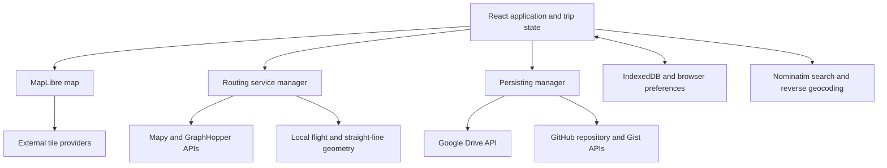

# Triplo functionality and architecture

Triplo is a browser-based trip logger and route planner. A trip combines ordered
segments with different transport modes, waypoints, and route geometry. It is
used to plan journeys or record travel after the fact; it does not record live
GPS tracks.

This document describes the implemented application. See [README.md](README.md)
for setup, configuration, and development commands, and [UI.md](UI.md) for the
interface and interaction flows.

## Functionality

- Create, edit, name, date, and delete trips containing multiple transport modes.
- Add, move, reorder, and remove waypoints, adjust segment boundaries, and split
  segments; maintain trip history with undo/redo and unsaved-change indicators.
- Calculate routes through external providers, retain imported track geometry,
  and display local great-circle or straight-line routes.
- Import GPX and GeoJSON tracks into segments; export trips and segments as GPX,
  optionally including Triplo metadata.
- Inspect distances, elevation profiles, points of interest, and travel totals
  by transport mode and year. Date and mode filters also affect map rendering.
- Customize appearance, transport mode names/icons/colors, default routing
  profiles, language preferences, and JavaScript render styles.
- Keep local trip data, connect Google Drive and/or GitHub storage, reconcile
  conflicting versions, and publish read-only trip shares.

## Runtime architecture

Triplo is a static React/TypeScript application built with Vite. It calls map,
routing, geocoding, and storage services directly from the browser. There is no
Triplo backend server, database service, API-key proxy, or Docker infrastructure.

| Component | Responsibility |
| --- | --- |
| [App.tsx](frontend/src/App.tsx) | Trip state, selected panels, history, save/reload, conflicts, sharing navigation, and responsive layout |
| [Map.tsx](frontend/src/components/Map.tsx) | MapLibre lifecycle, routes, markers, map selection, waypoint placement and dragging |
| [routing/](frontend/src/routing/) | Provider abstraction, default profiles, and geometry recalculation |
| [persisting/](frontend/src/persisting/) | Cloud storage, preference files, sharing, and connection settings |
| [utils/distance.ts](frontend/src/utils/distance.ts) | Segment/waypoint distance caches, elevation totals, and trip summaries |
| [utils/preferencesSync.ts](frontend/src/utils/preferencesSync.ts) | Preference and custom style synchronization |
| [utils/exportUtils.ts](frontend/src/utils/exportUtils.ts) | GPX/GeoJSON serialization and file downloads |
| [shared/types.ts](shared/types.ts) | Trip, segment, waypoint, and shared-reference types |

[api/client.ts](frontend/src/api/client.ts) is an in-memory adapter used by the
application, not an HTTP backend. Its sample data is disabled. Durable local
trip caching is handled separately in `App.tsx` using IndexedDB.

## Data model and formats

The native saved file is a JSON `Trip` object, not a GeoJSON FeatureCollection.
GeoJSON is used for the geometry inside segments and as a track interchange
format. The TypeScript definitions in [shared/types.ts](shared/types.ts) are the
canonical field reference.

### Trips

| Fields | Meaning |
| --- | --- |
| `id`, `name` | String identifier and display name |
| `description`, `startDate`, `endDate` | Optional description and travel dates |
| `segments` | Ordered array of embedded segment objects |
| `createdAt`, `updatedAt` | Creation and modification timestamps |
| `sourceService`, `metadata` | Optional source, sync, and sharing information |
| `tripDistanceSummary` | Optional cached total distance and distance by mode |

New trips use a temporary ID until saved. Saving assigns a name-based ID with a
random suffix. IDs are strings; a UUID format is not required.

### Segments

| Fields | Meaning |
| --- | --- |
| `id`, `name` | Identifier and optional label |
| `transportMode` | Built-in mode or `other` |
| `routingService`, `routingProfile` | Provider name and profile used for routing |
| `source` | `router`, `gpx`, or `manual` |
| `geometry` | GeoJSON LineString with longitude/latitude positions and optional elevation |
| `waypoints` | Ordered array of embedded waypoint objects |
| `customColor`, `customIcon`, `isHidden` | Optional presentation overrides |
| `distanceStats`, `waypointDistances` | Optional distance and elevation caches |
| `countryDistances` | Optional mapping from country code to kilometres; the only country analytics data added to trip JSON |

Segments can share a boundary waypoint ID. Editing operations update matching
waypoints across segments to keep the trip connected. A segment being built may
have only one waypoint; routed geometry needs at least two valid coordinates.
Teleport segments intentionally have empty geometry.

### Waypoints

Each waypoint has an `id` and WGS84 `coordinates` in **`[longitude, latitude]`**
order. Optional fields include `name`, `description`, `date`, `icon`, `picture`,
and an attached `poi` with its identifier, name, type, subtype, and details.
Waypoint visibility is controlled by render styles; the shared waypoint type
does not define an `importance` field.

### Track interchange and statistics

Track import lives in [SegmentInfo.tsx](frontend/src/components/SegmentInfo.tsx).
It reads GPX track/route points and GeoJSON LineString/MultiLineString geometry,
including features and feature collections. The resulting segment is marked
`source: 'gpx'`, with `routingService: 'gpx'` and an imported-track profile. The
user can align its endpoint waypoints with the imported track.

GPX serialization is implemented directly in `exportUtils.ts`; it does not use
`@we-gold/gpxjs`. Exports include track geometry and available elevation, with
optional Triplo extensions. GeoJSON export helpers are also available in that
module; the trip-sharing dialog exposes GPX download.

Distance summaries use stored geometry and fall back to straight-line waypoint
distances when usable geometry is missing. Elevation totals use available third
coordinates. Teleport segments are excluded from travel-distance aggregation.
Waypoint-to-waypoint distance calculations account for ordered positions along
routes that revisit the same location.

## Routing

[RoutingService.ts](frontend/src/routing/RoutingService.ts) defines
`IRoutingService`: a provider exposes its name, availability, attribution,
supported profiles, and `route(waypoints, profile)` returning a LineString.
Key-based providers also expose API-key configuration and testing hooks.

The current default assignments are:

| Transport mode | Default provider | Default profile |
| --- | --- | --- |
| `walk`, `run` | Mapy Router | `foot_fast` |
| `hike` | Mapy Router | `foot_hiking` |
| `bike` | GraphHopper Router | `bike` |
| `car`, `taxi`, `bus`, `ferry` | GraphHopper Router | `car` |
| `rail`, `subway` | Rail Router | `rail` (unavailable placeholder) |
| `flight` | Flight Router | `flight` |
| `other` | Straight Router | `straight` |

Preferences can override defaults, and segments can select a different provider
and profile. Custom modes use `transportMode: 'other'` with custom icon, color,
name, and routing preferences; the built-in mode type is a finite union.

Mapy and GraphHopper use hosted APIs with user-supplied keys. GraphHopper also
offers a ferry profile implemented through a car profile with a ferry-biased
custom model; it is distinct from the default `ferry` mode assignment above.
Flights use Turf great-circle geometry. Straight Router supports direct lines
and a `teleport` profile with no displayed route or distance.

Rail Router reports itself unavailable. There is no integrated OpenRailRouting
service or self-hosted GraphHopper backend. The routing manager falls back to
straight lines for unavailable services and prompts for a missing API key when
applicable. Request-error handling is provider-specific.

[routeOptimizer.ts](frontend/src/routing/routeOptimizer.ts) preserves imported
geometry and reuses unchanged routes. For edits to routed waypoints, it can
recalculate and splice the affected section; provider/profile changes and other
cases requiring a complete route trigger full recalculation.

## Persistence, synchronization, and sharing

[PersistingService.ts](frontend/src/persisting/PersistingService.ts) defines the
storage interface: load, save, delete, preference files, connection management,
and share operations. `PersistingManager` coordinates available providers.

| Store | Data and access |
| --- | --- |
| IndexedDB | Local trip cache in `TriploDB`; browser storage can be cleared independently of cloud files |
| Browser preferences | Appearance, API keys, connection state/tokens, and local UI settings in localStorage |
| Google Drive | `<id>.triplo.json` files in the selected folder, plus preferences and style scripts; OAuth `drive.file` access |
| GitHub repository | `trips/<id>.triplo.json`, `preferences.json`, and custom style files; authenticated Contents API access |

Loading combines local and connected-provider data by trip ID. Distinct remote
versions become conflicts; the newest version is displayed provisionally while
the user chooses which version to retain. The app also detects trips missing
from connected services and differing preference versions. The conflict dialog
supports version selection and uploads to missing services.

Editing updates React state and per-trip undo/redo history. Local trip state is
cached; explicit Save or Save All writes to connected providers and updates the
saved-state baseline. Preference changes use a separate synchronization path.
Country calculations attach per-segment country distance maps without creating
an undo step. Save and Save All persist only these maps in trip JSON. Clipped
routes, waypoint assignments, hashes, and versions remain browser-local.
Saved distance maps work without boundary downloads; a country selection can
prepare clipped rendering geometry in a fresh browser. Country-distance-only
differences are ignored for sync conflicts.
The worker runs after loading and normal geometry/mode/waypoint updates,
including routing and imports, independently of Analytics visibility. Analytics
receives available results every 500 ms and displays the current trip name.
Startup read-only and mobile-panel preferences remain local, while language,
appearance, map home, mode overrides, list settings, API keys, and custom styles
are synchronized. Custom style scripts are saved as separate files.

Public shares use an encoded provider reference in the app's `/share/<token>`
route. Google Drive shares grant read access to the owner's trip file; GitHub
shares use an unlisted Gist. These links provide read-only viewing to anyone
who has the link. Saving a shared trip to a user's collection stores a
`SharedTripReference`, not a permanent geometry snapshot. The source is fetched
again when loaded; revoked or deleted shares are marked unavailable and their
content is not retained in the local trip cache. Making a copy creates an
independent trip.

API keys and tokens are used client-side. Synced preferences include routing
keys in plain text. Google Drive sign-in and anonymous shared-trip loading also
depend on the build-time client configuration documented in the README.

## Maps, styles, and application delivery

[mapStyles.ts](frontend/src/config/mapStyles.ts) defines OpenFreeMap vector,
OpenStreetMap/OpenTopoMap raster, and Mapy outdoor base maps and POI layers.
These are alternative base maps, not a mandatory topographic overlay stack.
Nominatim provides place search and reverse-geocoded location details.

MapLibre renders route layers and markers. JavaScript style configurations in
[mapStylesPreferences.ts](frontend/src/utils/mapStylesPreferences.ts) are
evaluated in the browser and can supply `getWaypointStyle`, `getSegmentStyle`,
and map-style overrides. They receive selection/read-only context and control
visibility, colors, opacity, marker type, and line width. The built-in script is
[themes/default.js](frontend/src/themes/default.js). Analytics uses temporary
style configurations to filter displayed transport modes.

GitHub Actions validates PRs and deploys a static Pages site, including
same-repository PR previews. Build and deployment details are in the
[README](README.md#deployment-and-pull-request-previews) and
[workflows](.github/workflows/).

The manifest supports app installation, but the current service worker does not
cache the application or map tiles for offline use. Browser trip caching does
not make the complete app available offline. The existing Playwright suite uses
a real MapLibre map with local fixtures to verify mobile measurement and gesture
behavior; it is not coverage of every storage or editor workflow.
